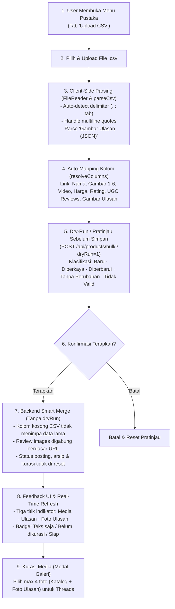

# Alur Upload File CSV ke Pustaka Produk (https://app.yuss.site/pustaka) — Versi 1.2

Catatan teknis dan panduan operasional sistem Pustaka Produk v1.2 (Satu Halaman untuk Semua Level CSV, Indikator Kelengkapan, Pratinjau Upload, dan Kurasi Media).

---

## 1. Diagram Alur Kerja (Workflow v1.2)

---

## 2. Tingkat Kelengkapan Data (*Completeness Level*)

Kelengkapan produk dihitung dinamis dari data yang terisi tanpa membatasi pengguna:

| Level | Data yang Terisi | Format Posting Threads |
| :--- | :--- | :--- |
| **Level 1 (Dasar)** | Link, nama, harga, komisi | Teks saja |
| **Level 2 (Media)** | + Foto katalog (1–6), video `.mp4`, deskripsi | + Foto katalog, video |
| **Level 3 (Ulasan)** | + Komentar kritis (bintang 3–4) & bukti (bintang 5) | + Hook & bukti sosial |
| **Level 4 (Lengkap)** | + Gambar ulasan pembeli (`Gambar Ulasan (JSON)`) | + Foto ulasan UGC asli |

---

## 3. Struktur Kolom CSV yang Didukung

Sistem mengenali file CSV bawaan Shopee Affiliate maupun CSV hasil Scraper Pro (23 kolom):

| Header CSV | Pemetaan Sistem | Keterangan |
| :--- | :--- | :--- |
| `ID Produk` / `Item ID` | `productId` | Kunci pencocokan utama produk Shopee |
| `Link Komisi Ekstra` / `Link Produk` | `link` | Tautan resmi Shopee affiliate |
| `Nama Produk` | `name` | Judul produk |
| `Link Gambar 1` s/d `Link Gambar 6` | `images` (array) | Galeri foto resmi katalog toko (maks 6) |
| `Link Video` | `video` | Video CDN seller format `.mp4` |
| `Harga`, `Komisi`, `Penjualan` / `Terjual` | `price`, `commission`, `sales` | Otomatis dinormalisasi jadi angka (termasuk format `1.2rb`, `1jt`) |
| `Rating` | `rating` | Skor bintang produk |
| `Deskripsi Lengkap` | `desc` | Uraian spesifikasi/deskripsi produk |
| `Review Kritis (Bintang 3-4)` | `reviewKritis` | Keluhan objektif pembeli untuk bahan HOOK |
| `Review Bukti (Bintang 5)` | `reviewBukti` | Testimoni kepuasan pembeli untuk bahan PROOF |
| `Gambar Ulasan (JSON)` | `reviewImages` | Array JSON foto ulasan asli UGC pembeli beserta variasi & komentar |

---

## 4. Alur Pratinjau Upload (*Upload Preview & Dry-Run*)

Ketika pengguna memilih file CSV:
1. File diparsing secara instan di browser.
2. Dikirim ke backend dengan flag `dryRun=1`:
   - `POST /api/products/bulk?dryRun=1`
3. Sistem mengklasifikasikan setiap baris:
   - 🔵 **Baru (`new`):** Produk belum ada di database.
   - 🟢 **Diperkaya (`enriched`):** Mengisi komponen yang tadinya kosong (misal menambahkan media, ulasan, atau foto ulasan).
   - 🟡 **Diperbarui (`updated`):** Terjadi perubahan data dinamis (harga, rating, terjual, atau penambahan foto ulasan).
   - ⚪ **Tanpa Perubahan (`unchanged` / `same`):** Seluruh kolom identik dengan data tersimpan.
   - 🔴 **Tidak Valid (`invalid` / `bad`):** Bukan tautan Shopee resmi.
4. **Validasi Tombol Terapkan:**
   - Tombol **"Terapkan"** hanya aktif jika ada data yang baru/diperkaya/diperbarui (`go > 0`).
   - Jika semua data identik, tombol dinonaktifkan dengan keterangan: *"File ini sama dengan data yang sudah ada, tidak ada yang berubah."*

---

## 5. Aturan Penggabungan Data (*Smart Re-Upload Rules*)

- **Kunci Pencocokan:** `productId` (atau item ID Shopee), cadangan: `link_key`.
- **Kolom Kosong di CSV:** **Tidak pernah** menimpa data lama yang sudah terisi.
- **Foto Ulasan (`Gambar Ulasan`):** Digabung berdasarkan URL gambar unik sehingga foto ulasan baru ditambahkan tanpa menghilangkan kurasi yang sudah ada.
- **Integritas Status:** Kolom `selectedMedia` (foto yang sudah dipilih), `postStatus`, dan status `archived` **tidak disentuh**.

---

## 6. Filter & Indikator UI Baru

### A. Tiga Titik Indikator Kelengkapan
Setiap baris produk menampilkan 3 penanda titik visual:
- **`Media [N]`**: Titik hijau jika memiliki foto katalog.
- **`Ulasan`**: Titik hijau jika memiliki teks ulasan kritis/bukti.
- **`Foto Ulasan [N]`**: Titik hijau jika memiliki foto ulasan UGC pembeli.

### B. Badge Status Kurasi
- **"Teks saja"**: Untuk produk yang tidak memiliki foto sama sekali.
- **"Belum dikurasi"**: Produk yang memiliki foto namun belum dipilih di galeri.
- **"Siap · N dipilih"**: Produk yang sudah dikurasi fotonya (1–4 foto).

### C. Filter *"Bisa Diperkaya"* & Salin Link
- Tab filter **"Bisa Diperkaya"** menyaring seluruh produk dengan `Level < 4`.
- Pada desktop ($\ge 900\text{px}$), tersedia tombol **"Salin link (untuk extension)"** untuk menyalin semua tautan produk yang belum lengkap, siap ditempelkan ke ekstensi Chrome Scraper di laptop.

---

## 7. Modal Kurasi Galeri Media

- Tombol kurasi (ikon gambar) hanya muncul pada produk yang memiliki foto.
- **Tab Dinamis:**
  - `Ulasan (N)` (nonaktif jika 0 ulasan)
  - `Katalog (N)` (nonaktif jika 0 foto katalog)
  - `Semua`
- **Filter Cepat:**
  - Checkbox *Sembunyikan video* (cover video ulasan).
  - Checkbox *Ada teks ulasan* (hanya tampilkan foto yang ada testimoni teksnya).
  - Dropdown filter *Variasi* (misal: "Cream", "Merah", "Biru").
- **Tombol "Pilih otomatis":** Otomatis memilih 3–4 foto ulasan UGC terbaik (mengutamakan ulasan pembeli dengan teks $\ge 15$ karakter).
- **Simpan & Navigasi Cepat:**
  - Tombol **"Simpan"** (`PATCH /api/products/:id/media`).
  - Tombol **"Simpan & Berikutnya"** untuk langsung melanjutkan kurasi ke produk berikutnya tanpa bolak-balik modal.
- **Responsif:** Tampilan layar penuh (*fullscreen*) pada perangkat seluler ($< 640\text{px}$).
